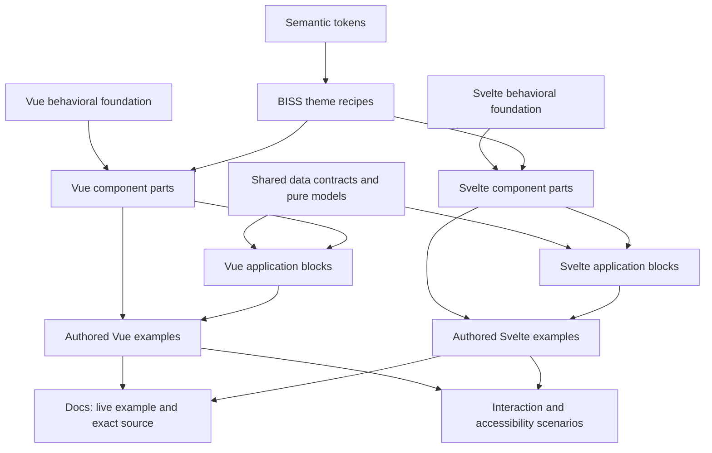

# Reference-led direction for BISS UI

Status: researched design and architecture direction. This is the target for the
next migration, not a claim that the present library already implements it.

The public libraries below are references for how a library operates as a system.
Bizzy remains the authority for BISS UI's visual language. The goal is to adopt
clear composition, reliable behavior and useful documentation while retaining
that identity.

## What the references actually do

| Reference | Evidence inspected | What BISS UI should adopt |
|---|---|---|
| [Reka UI](https://www.reka-ui.com/docs/components/dialog) | Dialog anatomy and controlled/uncontrolled state; [composition](https://www.reka-ui.com/docs/guides/composition); [Root implementation](https://github.com/unovue/reka-ui/blob/main/packages/core/src/Dialog/DialogRoot.vue) | Connected parts, scoped context, accessible relationships, explicit state ownership and render delegation |
| [Bits UI](https://www.bits-ui.com/docs/components/dialog) | Dialog architecture and parts; [child snippet](https://next.bits-ui.com/docs/child-snippet); [state management](https://www.bits-ui.com/docs/state-management); [part exports](https://github.com/huntabyte/bits-ui/blob/main/packages/bits-ui/src/lib/bits/dialog/exports.ts) | Svelte-native composition and binding, typed part props, coherent event/attribute merging |
| [Nuxt UI](https://ui.nuxt.com/docs/components/button) | Semantic [design system](https://ui.nuxt.com/docs/getting-started/theme/design-system); [theme structure](https://github.com/nuxt/ui/blob/v4/.github/contributing/theme-structure.md); runtime/theme source directories | Separate component theme recipes, named styling slots, predictable size/color/variant/state axes and documented customization |
| [shadcn/ui](https://ui.shadcn.com/docs/components/button) and [shadcn-vue](https://shadcn-vue.com/docs/introduction) | Component pages; [preview implementation](https://github.com/shadcn-ui/ui/blob/main/apps/v4/components/component-preview.tsx); [registry](https://ui.shadcn.com/docs/registry) | Live example beside its exact source, focused examples, application blocks, clear installation and ownership of customization |
| [Storybook](https://storybook.js.org/docs/writing-stories/play-function) | Stories, args, controls and executable interaction scenarios | Reusable state scenarios that power both the documentation and behavior tests |

These observations inform the recommendations below. They do not imply that all
references share one implementation or distribution model. Nuxt UI's framework
integration, shadcn's source distribution, and Reka/Bits' primitives solve different
problems. Copying all three models wholesale would produce another inconsistent
library.

## The important change: separate three layers

### 1. Behavioral primitives

Dialog, Popover, Menu, Select, Tabs and similar interactions expose connected parts:
Root, Trigger, Content, Title, Description, Item and Close where appropriate.

A Root owns context and state. Children receive IDs, handlers, accessibility
attributes and state through that context. Triggers can compose with BISS buttons,
router links or host components without creating nested interactive elements.
Controlled and uncontrolled usage are deliberate, documented contracts.

Recommendation: evaluate Reka for Vue and Bits for Svelte as the underlying
behavior providers. Keep BISS's public contracts and visual wrappers above them.
Validate the pairing in one component family before migrating the catalogue.
Do not expand a home-grown DOM toolkit just to duplicate mature focus, dismissal,
nesting, portal and keyboard behavior. Pure data logic can still be shared between
frameworks; framework reactivity and DOM ownership should remain framework-native.

### 2. Styled BISS components

Button, Field, Dialog, Select and Table provide the Bizzy appearance and useful
default composition. Expose an advanced composition path alongside convenient
wrappers. An existing `BissDialog` can remain a shorthand while a compound API
supports custom arrangements.

Give a component one theme recipe with explicit parts, for example:

- Button: root, label, leading icon, trailing icon, loading indicator.
- Dialog: overlay, content, header, title, description, body, footer, close.
- Select: trigger, value, indicator, content, viewport, item, item indicator.

Specify supported axes per family: size, visual variant, semantic color and state.
Share terminology, not a universal prop list that forces irrelevant options onto
every component. Provide semantic tokens globally and typed per-part customization
locally. Keep class, attributes and element refs usable through composition.

Nuxt UI is the strongest reference for this layer. Its Tailwind implementation is
not a requirement to adopt its separation of themes, slots and variants. BISS can
retain CSS variables and cascade layers.

### 3. Application blocks

SharePanel, RoleEditor, FilterBuilder, Agenda, dashboard widgets and record views
are compositions built from primitives and styled components. Document them as
blocks/patterns with explicit data and action adapters. They should not be counted
as interchangeable low-level controls or buried in the same navigation group.

A block shows how components work together. Its application state belongs to the
example or host, not to the primitive or theme layers.

The blocks ported from Bizzy's application layer follow this contract: Sidebar,
WorkspaceSwitcher, NotificationCenter, CommandMenu, ImportMapper, Feed and FeedItem,
KeyResult, FunnelChart, RingGauge, Tour, TemplateGallery, FeedbackDialog and
Lightbox. They take display-ready data and labels as props, report intent through
Vue emits/models and Svelte callbacks/bindings, and use Reka UI or Bits UI for
popover, dialog and focus behavior. Pure matching, filtering and geometry live in
`src/core/` with unit tests; their styles live in `src/styles/blocks.css`.

## Target repository boundaries

```text
packages/
  tokens/                 semantic values and generated outputs
  contracts/              data types and pure state/geometry helpers
  vue/
    primitives/dialog/    framework-native behavioral adapters
    components/dialog/    BISS styled parts and convenience wrapper
    components/button/
    blocks/share-panel/
  svelte/
    primitives/dialog/
    components/dialog/
    components/button/
    blocks/share-panel/
apps/
  docs/                   documentation shell and authored guides
  examples-vue/           compilable examples, stories and host integrations
  examples-svelte/
tests/
  contracts/              shared observable behavior, per-framework runners
  consumers/              installed-package type/build/SSR checks
```

These are build/workspace boundaries, not a demand to publish six npm packages.
Keep `biss-ui/vue`, `biss-ui/svelte`, CSS and token entry points initially. Split
published packages only when independent versioning or dependency isolation earns
that complexity. Leave caselaw-ui's existing release line independent.

## How components connect



Framework parity means the same observable capabilities and behavior, expressed
through idiomatic Vue emits/models/slots and Svelte bindings/callbacks/snippets.
It does not mean pretending both frameworks have the same rendering lifecycle.

## Documentation design

Use shadcn's component-first presentation, Reka/Bits' anatomy and behavior guidance,
and Nuxt UI's example-by-feature customization structure. Keep BISS's warm palette,
compact controls and typography; avoid turning the site into a generic marketing
page or retaining the Bizzy application shell unchanged as a docs shell.

### Information architecture

- Start: introduction, installation by framework, composition, theming,
  accessibility, migration and releases.
- Foundations: colors, typography, spacing, density, icons and motion.
- Components: basic controls and compound UI, grouped by task.
- Patterns/blocks: forms, tables, permissions, editors and application shells.
- Examples: complete workflows that use several components together.

Use a clear reading column, restrained persistent navigation, search and a compact
page outline. Show a framework selector consistently. Avoid a second state selector
whose relationship to the example is unclear. Responsive controls belong to the
preview, while styling/API controls belong to a specific example.

### Component page contract

1. Name, one-sentence purpose and guidance on when to use it.
2. A useful default live example with Preview/Code controls and copyable source.
3. Installation/import instructions, including required stylesheet/provider setup.
4. Anatomy: the parts and their relationships, with minimal composition code.
5. Focused live examples: sizes, variants, icons, loading/disabled, controlled state,
   composition, validation and custom content as applicable.
6. Customization: semantic tokens, styling parts and state/data attributes.
7. API by part: props, emitted changes/bindings, slots/snippets, refs and defaults.
8. Keyboard, focus and accessibility behavior plus relevant integration recipes.

Each example must be a real `.vue` or `.svelte` file. Render that file and display
its raw source. The visible code must include its actual state and handlers.
Do not synthesize usage code by serializing fixture props: that cannot explain
composition or reliably represent how an interactive example works.

Prefer inline rendering for ordinary controls. Use isolated frames for overlays,
responsive application blocks or themes that require a separate viewport. Keep
live rendering on both desktop and phone; do not adopt screenshot fallbacks just
because a reference site uses them for some large blocks.

## Examples, manifests and testing

An example manifest connects a component family to its Vue/Svelte example modules,
raw source, supported scenarios and testing metadata. It is not a giant renderer
with component-name conditionals. State scenarios such as disabled, loading and
invalid should be named examples with real behavior.

Generate API tables from explicit public types, then add authored explanations.
Keep generation scoped to public contracts and styling slots; do not treat an AST
inventory of implementation details as complete documentation.

Use a Storybook-style story/scenario contract for reusable interaction tests. A
public Storybook deployment is optional; a sound examples/test pipeline is not.
Keep installed-artifact and SSR checks alongside keyboard, nesting, form submission,
focus restoration and consumer customization checks.

## First migration: Dialog as a complete reference slice

Dialog exercises behavior, compound composition, theming, state, accessibility and
documentation. Migrate it end to end before applying the pattern to 130 components.

Acceptance criteria:

- Convenient `BissDialog` usage remains available.
- Advanced parts expose Root, Trigger, Content, Title, Description and Close.
- Host buttons and router links compose without extra interactive wrappers.
- Controlled/uncontrolled state and framework-native binding both work.
- Nested dialogs, outside interaction, Escape, focus restoration and SSR have tests.
- Bizzy styling comes from an explicit shared part/variant recipe.
- Docs render real Vue/Svelte examples and show those same source files.
- The page explains anatomy, customization and keyboard behavior.
- No changes to original Bizzy or the maintained caselaw-ui package.

Then migrate Button/Field, Popover/Menu/Select, Tabs and data-display foundations;
rebuild application blocks on those foundations; migrate the docs catalogue through
its example manifest. A source-copy registry/CLI can follow if consumers need code
ownership. It is not a prerequisite for a usable npm library.

## Implemented reference slice

Dialog now implements the connected parts above in both frameworks, with optional
Reka/Bits peer dependencies, direct Dialog subpaths and a shared size/part recipe.
The convenient wrapper supports native open binding and `ui` overrides. Four paired
authored examples run unchanged in the docs: basic, controlled validation, nested
layers and the wrapper. Their source view reads the same files. Browser checks
cover keyboard composition, focus trapping/restoration, outside dismissal, nested
Escape, validation and accessibility at 1440px and 390px. Installed-artifact tests
check SSR and public part types. The remaining families still need migration.
